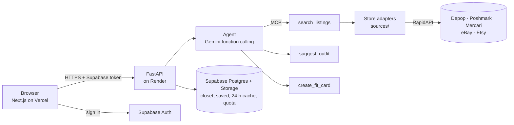

# FitFindr

[](https://github.com/Shawn-Bi/fitfindr-agent/actions/workflows/tests.yml)

**Find secondhand pieces that fit your wardrobe, not just your search.**

FitFindr is a secondhand-clothing search agent for US shoppers. Type what you
want in plain words ("vintage graphic tee under $30"). FitFindr searches US
resale stores, picks the best match, explains how to wear it with clothes from
your own closet and writes a short, shareable caption.

**Try it:** https://fitfindr-ten.vercel.app
(API: https://fitfindr-api.onrender.com/health. It runs on Render's free plan,
so the first request after 15 idle minutes takes about a minute.)

## What it does

- **Search in plain words.** The agent reads size, budget and style out of the
  sentence and shows them as chips you can remove. Filters cover price, size,
  condition, colour, gender, store and "listed within".
- **Real listings only.** Every result comes from a live store API, or from a
  cached copy of a real response no more than 24 hours old. The app never
  shows sample or invented listings.
- **Styling from your own closet.** Upload photos of your clothes; AI suggests
  the name, category, colours and style tags. The best match on each search
  comes with an outfit that names pieces you already own, shown as a collage.
- **Fit card.** A buyer's verdict (Worth it / Fair deal / Skip, with reasons)
  and a caption you can copy.
- **AI stylist per closet item.** Each piece you own gets a planned outfit,
  matched against real listings you could buy.
- **Saved items, a size and style profile, and full account deletion.**

## Stores

| Store | Source | Status |
|---|---|---|
| Depop, Poshmark, Mercari, eBay | Fashion Resale API (RapidAPI), one call covers all four | Live |
| Etsy | Etsy API (RapidAPI) | Live |
| Facebook Marketplace | Facebook Marketplace API (RapidAPI) | Coming soon |

Each API host has a free quota of 50 calls a month. FitFindr stops at 40. A
store that reaches the limit is **paused**: it serves its 24-hour cache, or the
app says when it resumes (the 1st of next month). Paused stores are never
filled with made-up data.

## How it works



The agent lets the model choose the next tool, inside rules written in code:

| Tool | What it does |
|---|---|
| `search_listings` | Searches the stores with the parsed query and filters. Exposed over MCP. |
| `relax_search` | Nothing matched: drops one constraint (size first, then budget +50%) once, and says so. |
| `suggest_outfit` | Styles one of the top results with the user's closet. |
| `create_fit_card` | Writes the buyer's verdict and caption for the styled item. |
| `ask_user` | The request is too vague to search: asks one short question. |

Code guards refuse out-of-order calls (styling before a search, a second
relax). Filters the user didn't remove always apply. After 8 tool calls, or if
the model fails, a deterministic policy finishes the run. When the model is
unavailable, results still show and the caption is written in code.

## Tech stack

| Layer | Choice |
|---|---|
| Frontend | Next.js (App Router) + Tailwind CSS, one responsive codebase for phone and desktop |
| Backend | FastAPI (Python), wrapping the agent in `backend/agent.py` |
| Database, auth, photos | Supabase (Postgres with row-level security, Auth, Storage) |
| LLM | Google Gemini (agent, styling, photo tagging, embeddings, LLM judge) |
| Tool protocol | MCP (`backend/mcp_server.py`) |
| Deploy | Vercel (frontend), Render (backend), GitHub Actions (tests) |

## Using FitFindr from another agent or app

FitFindr can be called three ways: as an **MCP tool** (`search_listings`), over
its **HTTP API**, or in-process through `run_agent()`. The inputs, outputs,
data shapes, quotas and a checklist for merging FitFindr into a larger product
are in **[docs/INTEGRATION.md](docs/INTEGRATION.md)**.

## Repository layout

```
backend/             FastAPI app, agent, tools, MCP server, store adapters
  agent.py           the tool-choosing agent (run_agent)
  tools.py           search_listings, suggest_outfit, create_fit_card
  mcp_server.py      search_listings over MCP
  sources/           one adapter per RapidAPI host + quota and cache
  api/main.py        HTTP routes
  run_eval.py        evaluation against backend/criteria.md
  tests/             unit tests; tests/fixtures/ = recorded real responses
frontend/            Next.js app (src/app/ = pages)
supabase/            schema.sql + migrations/
docs/                PRD, decisions, deploy guide, integration guide, reports, legal drafts
```

## Run it locally

You need Python 3.12, Node 20, a Supabase project, a Gemini API key and a
RapidAPI key subscribed to the store APIs above. The commands are for
PowerShell on Windows.

**One-time setup**

1. Copy `.env.example` to `.env` in the repo root and fill in the values. Never
   commit `.env`.
2. Create `frontend/.env.local` with `NEXT_PUBLIC_SUPABASE_URL`,
   `NEXT_PUBLIC_SUPABASE_ANON_KEY` and `NEXT_PUBLIC_API_URL=http://localhost:8000`.
3. Database: paste `supabase/schema.sql` into Supabase → SQL Editor → Run, then
   apply the migrations (needs `SUPABASE_DB_URL` in `.env`):

   ```powershell
   cd backend
   python -m venv .venv
   .venv\Scripts\Activate.ps1
   pip install -r requirements.txt
   $env:PYTHONUTF8=1
   python scripts/migrate.py
   ```

4. `cd frontend; npm install`

**Every time: live data with the 24 h cache**

Every store search is cached for 24 hours in Supabase, so repeating a search
costs nothing. A new search is one counted RapidAPI call per store host
(check the counts with `python -m sources.quota`).

Backend, in one terminal:

```powershell
cd backend
.venv\Scripts\Activate.ps1
$env:PYTHONUTF8=1
$env:FITFINDR_DATA_MODE='live'
uvicorn api.main:app --reload --port 8000
```

It worked when the log says `Uvicorn running on http://127.0.0.1:8000` and
http://localhost:8000/health shows `"data_mode":"live"`. Interactive API docs
are at http://localhost:8000/docs.

Frontend, in a second terminal:

```powershell
cd frontend
npm run dev
```

Open http://localhost:3000. It worked when the landing page shows the store
bar with the live stores.

## Tests (recorded fixtures, no live calls)

`backend/tests/fixtures/` holds recorded real API responses, used only for
tests and the eval (seller and shop profile fields removed). They load only
when `FITFINDR_DATA_MODE=fixtures`, and the backend refuses to start in
production with fixtures. Unit tests can't reach RapidAPI at all
(`backend/tests/__init__.py` blanks the key).

```powershell
cd backend
$env:PYTHONUTF8=1; $env:FITFINDR_DATA_MODE='fixtures'
python -m unittest discover -s tests -t .          # unit tests
python run_eval.py --label my-change               # criteria in backend/criteria.md (calls Gemini)
```

Playwright (375 px and 1280 px) runs against an API in fixtures mode:

```powershell
cd backend; $env:FITFINDR_DATA_MODE='fixtures'; uvicorn api.main:app --port 8000
cd frontend; npm run build; npm run start
cd frontend; npx playwright test
```

GitHub Actions runs the unit tests, lint, typecheck and build on every push,
with no keys.

## Deploy

[docs/DEPLOY.md](docs/DEPLOY.md): Render for the API, Vercel for the app,
Supabase for data. Production runs from branch `v2` (deployed 2026-10-19).

## Status and known limits

- Facebook Marketplace is not connected yet; the Location filter waits for it.
- Free tiers are small: 40 store calls a month per host, and Gemini's free
  daily limits. When embeddings run out, ranking falls back to keywords.
- "No longer available" on Saved can't trigger: the resale API sends no
  sold/status field.

The full list is in [BLOCKERS.md](BLOCKERS.md). Scope and decisions:
[docs/PRD.md](docs/PRD.md) (in Chinese), [docs/DECISIONS.md](docs/DECISIONS.md),
[docs/V2_REPORT.md](docs/V2_REPORT.md). Rules for working on the code
(including AI coding agents): [CLAUDE.md](CLAUDE.md).

## License

No license yet: all rights reserved. You're welcome to read the code and fork
it on GitHub. Please ask before reusing it elsewhere.
