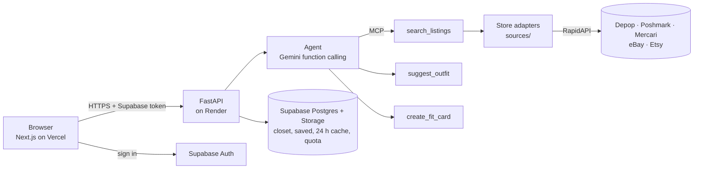

# FitFindr

[](https://github.com/Shawn-Bi/fitfindr-agent/actions/workflows/tests.yml)

**Find secondhand pieces that fit your wardrobe, not just your search.**

This repository extends my Unit 4 FitFindr agent (originally built in the course starter repo) into a full web app; it is an extension of that system, not a new project.

FitFindr is a secondhand-clothing search agent for US shoppers. Type what you
want in plain words ("vintage graphic tee under $30"). FitFindr searches US
resale stores, picks the best match, explains how to wear it with clothes from
your own closet and writes a short, shareable caption.

**Try it:** https://fitfindr-ten.vercel.app
(API: https://fitfindr-api.onrender.com/health. It runs on Render's free plan,
so the first request after 15 idle minutes takes about a minute.)

## What it does

- **Search in plain words.** The agent reads size, budget and style out of the
  sentence and shows them as chips you can remove. Filters cover price, size,
  condition, colour, gender, store and "listed within".
- **Real listings only.** Every result comes from a live store API, or from a
  cached copy of a real response no more than 24 hours old. The app never
  shows sample or invented listings.
- **Styling from your own closet.** Upload photos of your clothes; AI suggests
  the name, category, colours and style tags. The best match on each search
  comes with an outfit that names pieces you already own, shown as a collage.
- **Fit card.** A buyer's verdict (Worth it / Fair deal / Skip, with reasons)
  and a caption you can copy.
- **AI stylist per closet item.** Each piece you own gets a planned outfit,
  matched against real listings you could buy.
- **Saved items, a size and style profile, and full account deletion.**

## Stores

| Store | Source | Status |
|---|---|---|
| Depop, Poshmark, Mercari, eBay | Fashion Resale API (RapidAPI), one call covers all four | Live |
| Etsy | Etsy API (RapidAPI) | Live |
| Facebook Marketplace | Facebook Marketplace API (RapidAPI) | Coming soon |

Each API host has a free quota of 50 calls a month. FitFindr stops at 40. A
store that reaches the limit is **paused**: it serves its 24-hour cache, or the
app says when it resumes (the 1st of next month). Paused stores are never
filled with made-up data.

## How it works



The agent lets the model choose the next tool, inside rules written in code:

| Tool | What it does |
|---|---|
| `search_listings` | Searches the stores with the parsed query and filters. Exposed over MCP. |
| `relax_search` | Nothing matched: drops one constraint (size first, then budget +50%) once, and says so. |
| `suggest_outfit` | Styles one of the top results with the user's closet. |
| `create_fit_card` | Writes the buyer's verdict and caption for the styled item. |
| `ask_user` | The request is too vague to search: asks one short question. |

Code guards refuse out-of-order calls (styling before a search, a second
relax). Filters the user didn't remove always apply. After 8 tool calls, or if
the model fails, a deterministic policy finishes the run. When the model is
unavailable, results still show and the caption is written in code.

## Tech stack

| Layer | Choice |
|---|---|
| Frontend | Next.js (App Router) + Tailwind CSS, one responsive codebase for phone and desktop |
| Backend | FastAPI (Python), wrapping the agent in `backend/agent.py` |
| Database, auth, photos | Supabase (Postgres with row-level security, Auth, Storage) |
| LLM | Google Gemini (agent, styling, photo tagging, embeddings, LLM judge) |
| Tool protocol | MCP (`backend/mcp_server.py`) |
| Deploy | Vercel (frontend), Render (backend), GitHub Actions (tests) |

## Using FitFindr from another agent or app

FitFindr can be called three ways: as an **MCP tool** (`search_listings`), over
its **HTTP API**, or in-process through `run_agent()`. The inputs, outputs,
data shapes, quotas and a checklist for merging FitFindr into a larger product
are in **[docs/INTEGRATION.md](docs/INTEGRATION.md)**.

## Repository layout

```
backend/             FastAPI app, agent, tools, MCP server, store adapters
  agent.py           the tool-choosing agent (run_agent)
  tools.py           search_listings, suggest_outfit, create_fit_card
  mcp_server.py      search_listings over MCP
  sources/           one adapter per RapidAPI host + quota and cache
  api/main.py        HTTP routes
  run_eval.py        evaluation against backend/criteria.md
  tests/             unit tests; tests/fixtures/ = recorded real responses
frontend/            Next.js app (src/app/ = pages)
supabase/            schema.sql + migrations/
docs/                PRD, decisions, deploy guide, integration guide, reports, legal drafts
```

## Run it locally

You need Python 3.12, Node 20, a Supabase project, a Gemini API key and a
RapidAPI key subscribed to the store APIs above. The commands are for
PowerShell on Windows.

**One-time setup**

1. Copy `.env.example` to `.env` in the repo root and fill in the values. Never
   commit `.env`.
2. Create `frontend/.env.local` with `NEXT_PUBLIC_SUPABASE_URL`,
   `NEXT_PUBLIC_SUPABASE_ANON_KEY` and `NEXT_PUBLIC_API_URL=http://localhost:8000`.
3. Database: paste `supabase/schema.sql` into Supabase → SQL Editor → Run, then
   apply the migrations (needs `SUPABASE_DB_URL` in `.env`):

   ```powershell
   cd backend
   python -m venv .venv
   .venv\Scripts\Activate.ps1
   pip install -r requirements.txt
   $env:PYTHONUTF8=1
   python scripts/migrate.py
   ```

4. `cd frontend; npm install`

**Every time: live data with the 24 h cache**

Every store search is cached for 24 hours in Supabase, so repeating a search
costs nothing. A new search is one counted RapidAPI call per store host
(check the counts with `python -m sources.quota`).

Backend, in one terminal:

```powershell
cd backend
.venv\Scripts\Activate.ps1
$env:PYTHONUTF8=1
$env:FITFINDR_DATA_MODE='live'
uvicorn api.main:app --reload --port 8000
```

It worked when the log says `Uvicorn running on http://127.0.0.1:8000` and
http://localhost:8000/health shows `"data_mode":"live"`. Interactive API docs
are at http://localhost:8000/docs.

Frontend, in a second terminal:

```powershell
cd frontend
npm run dev
```

Open http://localhost:3000. It worked when the landing page shows the store
bar with the live stores.

## Tests (recorded fixtures, no live calls)

`backend/tests/fixtures/` holds recorded real API responses, used only for
tests and the eval (seller and shop profile fields removed). They load only
when `FITFINDR_DATA_MODE=fixtures`, and the backend refuses to start in
production with fixtures. Unit tests can't reach RapidAPI at all
(`backend/tests/__init__.py` blanks the key).

```powershell
cd backend
$env:PYTHONUTF8=1; $env:FITFINDR_DATA_MODE='fixtures'
python -m unittest discover -s tests -t .          # unit tests
python run_eval.py --label my-change               # criteria in backend/criteria.md (calls Gemini)
```

Playwright (375 px and 1280 px) runs against an API in fixtures mode:

```powershell
cd backend; $env:FITFINDR_DATA_MODE='fixtures'; uvicorn api.main:app --port 8000
cd frontend; npm run build; npm run start
cd frontend; npx playwright test
```

GitHub Actions runs the unit tests, lint, typecheck and build on every push,
with no keys.

## Deploy

[RUNNING.md](RUNNING.md): the live URLs, how to run it, logs and the benchmark.
[docs/DEPLOY.md](docs/DEPLOY.md): Render for the API, Vercel for the app,
Supabase for data. Production runs from branch `v2` (deployed 2026-10-19).

## Status and known limits

- Facebook Marketplace is not connected yet; the Location filter waits for it.
- Free tiers are small: 40 store calls a month per host, and Gemini's free
  daily limits. When embeddings run out, ranking falls back to keywords.
- "No longer available" on Saved can't trigger: the resale API sends no
  sold/status field.

The full list is in [BLOCKERS.md](BLOCKERS.md). Scope and decisions:
[docs/PRD.md](docs/PRD.md), [docs/DECISIONS.md](docs/DECISIONS.md),
[docs/V2_REPORT.md](docs/V2_REPORT.md). Rules for working on the code
(including AI coding agents): [CLAUDE.md](CLAUDE.md).

## License

No license yet: all rights reserved. You're welcome to read the code and fork
it on GitHub. Please ask before reusing it elsewhere.

## Capstone

**What This Extends.** This repo grew from my Unit 4 FitFindr agent: the
tool-choosing loop (`agent.py`) with `search_listings` served over MCP,
`suggest_outfit` and `create_fit_card`. Before the capstone it had already
become the web app described above (Next.js and FastAPI, Supabase accounts,
closet photos, the AI stylist, six stores through three RapidAPI hosts) and
already had some failure handling:

- A store that fails inside a search is caught on its own, so one broken store
  does not crash the search (`sources/__init__.py`). The response marks it
  `error`, and the UI shows "unavailable" with no reason.
- A store at its monthly stop line is `paused`, serves its 24-hour cache, and
  says when it resumes. If the counter can't be read, no live call is made.
- Each live request has a fixed timeout and is never retried, because a retry
  costs quota. Failures are written to the server log only as a stack trace.
- When the model is down, search results still show and the caption is written
  in code.

What is new in the capstone is the layer between those pieces and the user:
failures are classified (timeout, 403, 429, quota stop line, malformed JSON,
other), a timeout or a 429 gets one retry with backoff, every store reports a
status and a plain-words reason in the API response and the UI, bad data is
rejected before it can be cached, every failure is logged as structured JSON,
and `FITFINDR_FAIL_STORE` triggers each failure on purpose so it can be tested
without spending quota. Details: [docs/FAILURE_HANDLING.md](docs/FAILURE_HANDLING.md).

**The Shape.** Shape B, "Harden against failure". When any store API fails
(timeout, 403, 429, the quota stop line, or malformed JSON), search still
returns the other stores' results, shows which store is unavailable and why in
plain words, and logs the failure. Out of scope: adding new stores, the
stylist, and any UI redesign.

**Running It.** Path A is the deployed app: open https://fitfindr-ten.vercel.app
(wake the API first by opening https://fitfindr-api.onrender.com/health and
waiting for `{"ok":true,...}`; Render's free plan sleeps after 15 idle minutes).
[RUNNING.md](RUNNING.md) has the deploy details, the local backup (Path B), how
to force a store failure and how the log and the benchmark work. The trials below
ran against a local copy of the same code, because `FITFINDR_FAIL_STORE` is
refused when `APP_ENV=production`:

```powershell
cd backend; .venv\Scripts\Activate.ps1
python ../capstone/run_trials.py prime  --label prime    # the only step that spends RapidAPI calls (5)
python ../capstone/run_trials.py trials --label run1     # 3 trials x 10 searches, no live calls
```

**Instrumentation.** Every `POST /search` writes one JSON record
(`backend/searchlog.py`) to `backend/logs/searches.jsonl` and to the `traces`
table, including searches that fail. A record holds: `ts` (UTC), `run_id`,
`query`, `filters`, `outcome` (`completed`, `empty`, `all_stores_down`,
`rejected`, `error`), `result_count`, `total_latency_ms`, `partial`,
`failed_stores`, `stores_called`, `live_calls`, one entry per store in `stores`
(`status`, `kind` = error type, `reason`, `attempts` = 1 + retries,
`latency_ms`, redacted `error`, `results`), `tokens`
(`prompt`, `output`, `model_calls`) and `cost_usd`. No key, user id or listing
text is ever written. Each failed store attempt also logs a `store_failure` line
(`sources/failures.py::log_failure`). Ten real records (run 1, trial 1; Etsy
forced to time out, the other stores served from the 24 h cache):

```json
{"ts": "2026-11-18T05:02:03.050+00:00", "run_id": "2815b338bfff", "query": "vintage graphic tee", "filters": {}, "signed_in": false, "data_mode": "live", "outcome": "completed", "error": null, "result_count": 20, "total_latency_ms": 16743, "partial": true, "failed_stores": ["etsy"], "stores_called": ["etsy"], "live_calls": 0, "stores": [{"platform": "depop", "status": "cached", "results": 7, "latency_ms": 0}, {"platform": "poshmark", "status": "cached", "results": 1, "latency_ms": 0}, {"platform": "mercari", "status": "cached", "results": 0, "latency_ms": 0}, {"platform": "ebay", "status": "cached", "results": 12, "latency_ms": 0}, {"platform": "etsy", "status": "error", "results": 0, "kind": "timeout", "reason": "took too long to answer", "attempts": 2, "latency_ms": 1500, "error": "injected (FITFINDR_FAIL_STORE)"}, {"platform": "fb_marketplace", "status": "coming_soon", "results": 0}], "tokens": {"prompt": 3031, "output": 293, "model_calls": 5}, "cost_usd": 0.00042}
{"ts": "2026-11-18T05:02:23.338+00:00", "run_id": "bbf9028955f6", "query": "denim jacket", "filters": {}, "signed_in": false, "data_mode": "live", "outcome": "completed", "error": null, "result_count": 20, "total_latency_ms": 7014, "partial": true, "failed_stores": ["etsy"], "stores_called": ["etsy"], "live_calls": 0, "stores": [{"platform": "depop", "status": "cached", "results": 2, "latency_ms": 0}, {"platform": "poshmark", "status": "cached", "results": 0, "latency_ms": 0}, {"platform": "mercari", "status": "cached", "results": 0, "latency_ms": 0}, {"platform": "ebay", "status": "cached", "results": 18, "latency_ms": 0}, {"platform": "etsy", "status": "error", "results": 0, "kind": "timeout", "reason": "took too long to answer", "attempts": 2, "latency_ms": 1500, "error": "injected (FITFINDR_FAIL_STORE)"}, {"platform": "fb_marketplace", "status": "coming_soon", "results": 0}], "tokens": {"prompt": 3008, "output": 290, "model_calls": 5}, "cost_usd": 0.000417}
{"ts": "2026-11-18T05:02:54.186+00:00", "run_id": "89a58fb24cba", "query": "flannel shirt", "filters": {}, "signed_in": false, "data_mode": "live", "outcome": "completed", "error": null, "result_count": 20, "total_latency_ms": 7854, "partial": true, "failed_stores": ["etsy"], "stores_called": ["etsy"], "live_calls": 0, "stores": [{"platform": "depop", "status": "cached", "results": 10, "latency_ms": 0}, {"platform": "poshmark", "status": "cached", "results": 0, "latency_ms": 0}, {"platform": "mercari", "status": "cached", "results": 0, "latency_ms": 0}, {"platform": "ebay", "status": "cached", "results": 10, "latency_ms": 0}, {"platform": "etsy", "status": "error", "results": 0, "kind": "timeout", "reason": "took too long to answer", "attempts": 2, "latency_ms": 1500, "error": "injected (FITFINDR_FAIL_STORE)"}, {"platform": "fb_marketplace", "status": "coming_soon", "results": 0}], "tokens": {"prompt": 3039, "output": 281, "model_calls": 5}, "cost_usd": 0.000416}
{"ts": "2026-11-18T05:03:22.628+00:00", "run_id": "c3dd5bbe4c16", "query": "corduroy pants", "filters": {}, "signed_in": false, "data_mode": "live", "outcome": "completed", "error": null, "result_count": 20, "total_latency_ms": 6309, "partial": true, "failed_stores": ["etsy"], "stores_called": ["etsy"], "live_calls": 0, "stores": [{"platform": "depop", "status": "cached", "results": 2, "latency_ms": 0}, {"platform": "poshmark", "status": "cached", "results": 0, "latency_ms": 0}, {"platform": "mercari", "status": "cached", "results": 0, "latency_ms": 0}, {"platform": "ebay", "status": "cached", "results": 18, "latency_ms": 0}, {"platform": "etsy", "status": "error", "results": 0, "kind": "timeout", "reason": "took too long to answer", "attempts": 2, "latency_ms": 1500, "error": "injected (FITFINDR_FAIL_STORE)"}, {"platform": "fb_marketplace", "status": "coming_soon", "results": 0}], "tokens": {"prompt": 3131, "output": 319, "model_calls": 5}, "cost_usd": 0.000441}
{"ts": "2026-11-18T05:03:52.976+00:00", "run_id": "1e8aac5f490b", "query": "white denim pants", "filters": {}, "signed_in": false, "data_mode": "live", "outcome": "completed", "error": null, "result_count": 20, "total_latency_ms": 6648, "partial": true, "failed_stores": ["etsy"], "stores_called": ["etsy"], "live_calls": 0, "stores": [{"platform": "depop", "status": "cached", "results": 8, "latency_ms": 0}, {"platform": "poshmark", "status": "cached", "results": 0, "latency_ms": 0}, {"platform": "mercari", "status": "cached", "results": 0, "latency_ms": 0}, {"platform": "ebay", "status": "cached", "results": 12, "latency_ms": 0}, {"platform": "etsy", "status": "error", "results": 0, "kind": "timeout", "reason": "took too long to answer", "attempts": 2, "latency_ms": 1515, "error": "injected (FITFINDR_FAIL_STORE)"}, {"platform": "fb_marketplace", "status": "coming_soon", "results": 0}], "tokens": {"prompt": 2982, "output": 280, "model_calls": 5}, "cost_usd": 0.00041}
{"ts": "2026-11-18T05:04:24.774+00:00", "run_id": "65cd24e7b5e5", "query": "vintage graphic tee", "filters": {}, "signed_in": false, "data_mode": "live", "outcome": "completed", "error": null, "result_count": 20, "total_latency_ms": 8448, "partial": true, "failed_stores": ["etsy"], "stores_called": ["etsy"], "live_calls": 0, "stores": [{"platform": "depop", "status": "cached", "results": 7, "latency_ms": 0}, {"platform": "poshmark", "status": "cached", "results": 1, "latency_ms": 0}, {"platform": "mercari", "status": "cached", "results": 0, "latency_ms": 0}, {"platform": "ebay", "status": "cached", "results": 12, "latency_ms": 0}, {"platform": "etsy", "status": "error", "results": 0, "kind": "timeout", "reason": "took too long to answer", "attempts": 2, "latency_ms": 1500, "error": "injected (FITFINDR_FAIL_STORE)"}, {"platform": "fb_marketplace", "status": "coming_soon", "results": 0}], "tokens": {"prompt": 3021, "output": 302, "model_calls": 5}, "cost_usd": 0.000423}
{"ts": "2026-11-18T05:04:53.934+00:00", "run_id": "740a41813422", "query": "denim jacket", "filters": {}, "signed_in": false, "data_mode": "live", "outcome": "completed", "error": null, "result_count": 20, "total_latency_ms": 7614, "partial": true, "failed_stores": ["etsy"], "stores_called": ["etsy"], "live_calls": 0, "stores": [{"platform": "depop", "status": "cached", "results": 2, "latency_ms": 0}, {"platform": "poshmark", "status": "cached", "results": 0, "latency_ms": 0}, {"platform": "mercari", "status": "cached", "results": 0, "latency_ms": 0}, {"platform": "ebay", "status": "cached", "results": 18, "latency_ms": 0}, {"platform": "etsy", "status": "error", "results": 0, "kind": "timeout", "reason": "took too long to answer", "attempts": 2, "latency_ms": 1500, "error": "injected (FITFINDR_FAIL_STORE)"}, {"platform": "fb_marketplace", "status": "coming_soon", "results": 0}], "tokens": {"prompt": 2956, "output": 249, "model_calls": 5}, "cost_usd": 0.000395}
{"ts": "2026-11-18T05:05:23.599+00:00", "run_id": "80d2009b623b", "query": "flannel shirt", "filters": {}, "signed_in": false, "data_mode": "live", "outcome": "completed", "error": null, "result_count": 20, "total_latency_ms": 7268, "partial": true, "failed_stores": ["etsy"], "stores_called": ["etsy"], "live_calls": 0, "stores": [{"platform": "depop", "status": "cached", "results": 10, "latency_ms": 0}, {"platform": "poshmark", "status": "cached", "results": 0, "latency_ms": 0}, {"platform": "mercari", "status": "cached", "results": 0, "latency_ms": 0}, {"platform": "ebay", "status": "cached", "results": 10, "latency_ms": 0}, {"platform": "etsy", "status": "error", "results": 0, "kind": "timeout", "reason": "took too long to answer", "attempts": 2, "latency_ms": 1500, "error": "injected (FITFINDR_FAIL_STORE)"}, {"platform": "fb_marketplace", "status": "coming_soon", "results": 0}], "tokens": {"prompt": 3059, "output": 313, "model_calls": 5}, "cost_usd": 0.000431}
{"ts": "2026-11-18T05:05:52.880+00:00", "run_id": "9539775af8df", "query": "corduroy pants", "filters": {}, "signed_in": false, "data_mode": "live", "outcome": "completed", "error": null, "result_count": 20, "total_latency_ms": 6548, "partial": true, "failed_stores": ["etsy"], "stores_called": ["etsy"], "live_calls": 0, "stores": [{"platform": "depop", "status": "cached", "results": 2, "latency_ms": 0}, {"platform": "poshmark", "status": "cached", "results": 0, "latency_ms": 0}, {"platform": "mercari", "status": "cached", "results": 0, "latency_ms": 0}, {"platform": "ebay", "status": "cached", "results": 18, "latency_ms": 0}, {"platform": "etsy", "status": "error", "results": 0, "kind": "timeout", "reason": "took too long to answer", "attempts": 2, "latency_ms": 1500, "error": "injected (FITFINDR_FAIL_STORE)"}, {"platform": "fb_marketplace", "status": "coming_soon", "results": 0}], "tokens": {"prompt": 3053, "output": 292, "model_calls": 5}, "cost_usd": 0.000422}
{"ts": "2026-11-18T05:06:21.571+00:00", "run_id": "fed4ea39aaa8", "query": "white denim pants", "filters": {}, "signed_in": false, "data_mode": "live", "outcome": "completed", "error": null, "result_count": 20, "total_latency_ms": 5246, "partial": true, "failed_stores": ["etsy"], "stores_called": ["etsy"], "live_calls": 0, "stores": [{"platform": "depop", "status": "cached", "results": 8, "latency_ms": 0}, {"platform": "poshmark", "status": "cached", "results": 0, "latency_ms": 0}, {"platform": "mercari", "status": "cached", "results": 0, "latency_ms": 0}, {"platform": "ebay", "status": "cached", "results": 12, "latency_ms": 0}, {"platform": "etsy", "status": "error", "results": 0, "kind": "timeout", "reason": "took too long to answer", "attempts": 2, "latency_ms": 1500, "error": "injected (FITFINDR_FAIL_STORE)"}, {"platform": "fb_marketplace", "status": "coming_soon", "results": 0}], "tokens": {"prompt": 2952, "output": 264, "model_calls": 5}, "cost_usd": 0.000401}
```

A failed run (every store forced to time out with `FITFINDR_FAIL_STORE='*:timeout'`;
file `capstone/runs/failed_run/records.jsonl`): `outcome` is `all_stores_down`, no results,
all five stores carry `kind: timeout` and `attempts: 2`.

```json
{"ts": "2026-11-18T05:20:13.079+00:00", "run_id": "1674bcd18ee1", "query": "denim jacket", "filters": {}, "signed_in": false, "data_mode": "live", "outcome": "all_stores_down", "error": null, "result_count": 0, "total_latency_ms": 6004, "partial": false, "failed_stores": ["depop", "ebay", "etsy", "mercari", "poshmark"], "stores_called": ["depop", "poshmark", "mercari", "ebay", "etsy"], "live_calls": 0, "stores": [{"platform": "depop", "status": "error", "results": 0, "kind": "timeout", "reason": "took too long to answer", "attempts": 2, "latency_ms": 1500, "error": "injected (FITFINDR_FAIL_STORE)"}, {"platform": "poshmark", "status": "error", "results": 0, "kind": "timeout", "reason": "took too long to answer", "attempts": 2, "latency_ms": 1500, "error": "injected (FITFINDR_FAIL_STORE)"}, {"platform": "mercari", "status": "error", "results": 0, "kind": "timeout", "reason": "took too long to answer", "attempts": 2, "latency_ms": 1500, "error": "injected (FITFINDR_FAIL_STORE)"}, {"platform": "ebay", "status": "error", "results": 0, "kind": "timeout", "reason": "took too long to answer", "attempts": 2, "latency_ms": 1500, "error": "injected (FITFINDR_FAIL_STORE)"}, {"platform": "etsy", "status": "error", "results": 0, "kind": "timeout", "reason": "took too long to answer", "attempts": 2, "latency_ms": 1500, "error": "injected (FITFINDR_FAIL_STORE)"}, {"platform": "fb_marketplace", "status": "coming_soon", "results": 0}], "tokens": {"prompt": 0, "output": 0, "model_calls": 0}, "cost_usd": 0.0}
```

**Run Log and Verdicts.** Setup for every trial: local server (`uvicorn`, a separate
process, so latency includes HTTP), warmed with 2 searches that are not counted,
`FITFINDR_FAIL_STORE=etsy:timeout`, the RapidAPI key blanked (no live call possible),
the model response cache off. The 24 h cache was empty (the newest entry was a month old), so
`capstone/run_trials.py prime` first made **5 live calls to the Fashion Resale host**
(one per query, counted by `sources/quota.py`: the November counter went 0 to 5); the trials then
ran the same 5 queries twice each (10 searches), served from that cache, so the other stores
really answered. One trial's 10 searches serve criteria 1 to 5, because all ten are
forced-failure searches. Searches are 30 s apart: one search makes about 5 model calls and the
free Gemini tier allows 15 a minute (`generate.py::_wait_for_slot`). A first attempt with
6.6 s spacing was thrown away because it measured that throttle (`capstone/discarded/`).
Trials 1 to 3 changed nothing in between.

| Criterion | Target | Run 1 | Run 2 | Run 3 | Verdict |
|---|---|---|---|---|---|
| 1. Results despite one store timing out | at least 9/10 searches return results | 10/10 | 10/10 | 10/10 | MET |
| 2. Failed store named, with the reason | at least 9/10 | 10/10 | 10/10 | 10/10 | MET |
| 3. Search finishes in under 3 s (warm) | at least 9/10 under 3 s | 0/10 (mean 8.0 s) | 0/10 (mean 6.4 s) | 0/10 (mean 6.1 s) | MISSED |
| 4. One complete log record per failed store call | 10/10 | 10/10 | 10/10 | 10/10 | MET |
| 5. Average cost per search | under $0.01 | $0.000418 | $0.000423 | $0.000423 | MET |

Real output for each criterion, from run 1 (trial 2, raw files in `capstone/runs/run1/trial2/`):

- **Criteria 1 and 2.** `search_01.json`, written by `capstone/run_trials.py::run_searches` from the
  response of `api/main.py::search` (the sentence comes from `api/catalog.py::store_notices`):
  `http_status 200`, `result_count 20`, `store_notices ['Etsy took too long to answer.']`; the
  per-store panel shows eBay, Depop and Poshmark `live`, Etsy `error`, kind `timeout`.
  Scored on the API response, which the results page prints as-is (`frontend/src/app/search/page.tsx`
  renders `data.store_notices`); I did not screenshot the page.
- **Criterion 3.** The `client_latency_ms` field of the same ten files, measured by
  `run_trials.py::post_search` around the HTTP call: [6296, 6599, 5854, 6266, 6147, 6230, 6328, 7478, 7006, 5842] ms. The fastest of all 30 searches was 5,265 ms.
- **Criterion 4.** `records.jsonl`, written by `searchlog.py::write`. The Etsy entry of the first record:
  `{"platform": "etsy", "status": "error", "results": 0, "kind": "timeout", "reason": "took too long to answer", "attempts": 2, "latency_ms": 1500, "error": "injected (FITFINDR_FAIL_STORE)"}` with `ts` `2026-11-18T05:06:57.878+00:00`: store, error type (`kind`), latency
  (`latency_ms`) and retries (`attempts` 2 = 1 retry) all present, 10 records for 10 searches. Scored by
  `run_trials.py::score`.
- **Criterion 5.** The `tokens` and `cost_usd` fields of the same records: for the first record
  `{"prompt": 3005, "output": 310, "model_calls": 5}`, `cost_usd 0.000425`. Tokens are counted by
  `generate.py` from Gemini's usage metadata and priced by `config.py::estimated_cost`; mean over
  the 10 searches is $0.000423.

Summaries per trial: `capstone/runs/run1/summary.json`; console output: `capstone/runs/run1_console.txt`.
